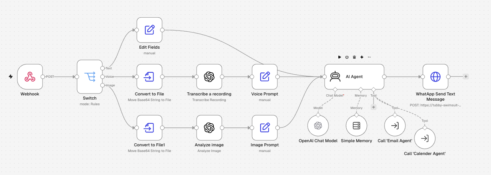

# WhatsApp Multi-Modal AI Agent | n8n Automation

An intelligent WhatsApp AI Agent built with n8n, Evolution API, and OpenAI. It supports text messages, voice notes, and image analysis, with additional capabilities for email and calendar automation through specialized AI Agents.

## Overview

This project demonstrates how to build a multi-modal AI Agent that interacts with users through WhatsApp.

The workflow receives incoming messages through an Evolution API Webhook and automatically identifies their type: Text, Voice, or Image.

Each message type follows a dedicated processing path before reaching the main AI Agent.

The AI Agent uses OpenAI as its language model, Simple Memory to maintain conversational context, and specialized Email and Calendar Agents as tools to perform additional tasks.

Finally, the generated response is sent back to the user through WhatsApp.

## 🎥 Project Demo

[](https://youtu.be/9Ka1qg-YfoI)

## 🔄 Workflow Preview



## Workflow Architecture

```text
                    WhatsApp User
                          |
                          v
                       Webhook
                          |
                          v
                        Switch
                    (Message Type)
                          |
           +--------------+--------------+
           |              |              |
           v              v              v
         Text            Voice          Image
           |              |              |
           v              v              v
       Edit Fields    Convert to File  Convert to File
           |              |              |
           |              v              v
           |         Transcribe a      Analyze Image
           |         Recording         (OpenAI)
           |              |              |
           |              v              v
           |        Voice Prompt     Image Prompt
           |              |              |
           +--------------+--------------+
                          |
                          v
                       AI Agent
                          |
             +------------+------------+
             |            |            |
             v            v            v
         Chat Model     Memory        Tools
         (OpenAI)       (Simple       /    \
                        Memory)       v    v
                                  Email   Calendar
                                  Agent   Agent
                                     \    /
                                      v  v
                                  AI Response
                                       |
                                       v
                              WhatsApp Send Text
                                       |
                                       v
                                  WhatsApp User
```

## Features

- **WhatsApp Integration:** Receives and sends messages using Evolution API.
- **Webhook Trigger:** Automatically processes incoming WhatsApp messages.
- **Multi-Modal Input:** Supports text, voice, and image messages.
- **Smart Message Routing:** Uses a Switch node to identify and route messages based on their type.
- **Voice Transcription:** Converts incoming voice recordings into text using OpenAI.
- **Image Analysis:** Uses OpenAI to understand and analyze incoming images.
- **AI Agent:** Combines different input types into a unified conversational experience.
- **Conversation Memory:** Uses Simple Memory to maintain conversational context.
- **Email Automation:** Integrates a specialized Email Agent as an AI Agent tool.
- **Calendar Automation:** Integrates a specialized Calendar Agent as an AI Agent tool.
- **Modular Architecture:** Uses dedicated agents and reusable workflows to separate responsibilities.
- **Automated WhatsApp Replies:** Sends the AI-generated response directly back to the user.

## Workflow Breakdown

### 1. Webhook & Message Routing

- **Webhook:** Receives incoming WhatsApp events from Evolution API.
- **Switch:** Identifies the incoming message type and routes it to the appropriate processing branch.

The workflow supports three input types:

- Text
- Voice
- Image

### 2. Text Processing

**Edit Fields**

Processes and prepares the incoming text message before passing it to the main AI Agent.

### 3. Voice Processing

The voice branch consists of three nodes:

1. **Convert to File:** Converts the incoming Base64 audio data into a file.
2. **Transcribe a Recording:** Uses OpenAI to transcribe the voice recording into text.
3. **Voice Prompt:** Prepares the transcription for the AI Agent.

### 4. Image Processing

The image branch also consists of three nodes:

1. **Convert to File:** Converts the incoming Base64 image data into a file.
2. **Analyze Image:** Uses OpenAI to analyze the image and understand its visual content.
3. **Image Prompt:** Prepares the image analysis results for the AI Agent.

### 5. Main AI Agent

The three processing branches converge into one AI Agent.

The agent is connected to three main components:

**OpenAI Chat Model**
- Provides the language model used to understand user requests and generate responses.

**Simple Memory**
- Maintains conversational context between interactions.

**Specialized AI Agent Tools**
- **Email Agent:** Handles email-related tasks.
- **Calendar Agent:** Handles calendar-related tasks.

This architecture allows the main agent to handle general conversations and delegate specialized tasks to dedicated agents.

### 6. WhatsApp Response

**WhatsApp Send Text Message**

After processing the user's request, the AI Agent generates a response and sends it back through Evolution API.

## Technologies Used

- [n8n](https://n8n.io/) — Workflow automation and orchestration.
- [Evolution API](https://evolution-api.com/) — WhatsApp integration.
- [OpenAI](https://openai.com/) — Language processing, voice transcription, and image analysis.
- **AI Agent** — Intelligent conversational processing.
- **Simple Memory** — Conversation context management.
- **Webhooks** — Real-time event handling.
- **HTTP Request / API Integration** — Communication with external services.
- **Sub-workflows / AI Agent Tools** — Modular task execution.

## Setup Instructions

### 1. Requirements

- An n8n instance (Cloud or Self-hosted).
- Evolution API configured and connected to WhatsApp.
- OpenAI API credentials.
- Email service credentials for the Email Agent.
- Calendar service credentials for the Calendar Agent.
- The required main workflow and supporting agent workflows.

### 2. Import the Workflows

1. Download the workflow JSON files from this repository.
2. Open your n8n instance.
3. Import the main WhatsApp workflow.
4. Import the Email Agent and Calendar Agent workflows.
5. Verify the AI Agent tool connections and workflow references.

### 3. Configure Evolution API

1. Configure your Evolution API instance.
2. Connect your WhatsApp account.
3. Configure the webhook URL in Evolution API.
4. Enable the required incoming message events.
5. Verify that incoming messages reach the n8n Webhook.

### 4. Configure OpenAI

1. Add your OpenAI API credentials in n8n.
2. Configure the OpenAI Chat Model.
3. Configure the audio transcription node.
4. Configure the image analysis node.

### 5. Configure Email & Calendar Agents

1. Configure the Email Agent and its required credentials.
2. Configure the Calendar Agent and its required credentials.
3. Verify that both agents are correctly connected as tools to the main AI Agent.
4. Test their functionality independently.

### 6. Activate the Workflow

1. Verify all credentials and integrations.
2. Activate the main workflow.
3. Send a text message to your WhatsApp account.
4. Test with a voice recording.
5. Send an image and test image understanding.
6. Test email and calendar requests.
7. Receive the generated responses directly on WhatsApp.

## Example Interactions

| Input Type | Example | Processing |
|---|---|---|
| Text | Hello, how can you help me? | Main AI Agent |
| Voice | Send a voice question | Audio Transcription → AI Agent |
| Image | Send a product or document photo | OpenAI Image Analysis → AI Agent |
| Email Task | Send an email to a contact | Email Agent |
| Calendar Task | Schedule a meeting | Calendar Agent |

## Security Notes

- Never commit API keys or access tokens to GitHub.
- Store credentials securely inside n8n.
- Protect webhook endpoints from unauthorized access.
- Avoid exposing Evolution API credentials.
- Review exported workflow JSON files before publishing.
- Use appropriate permissions for email and calendar integrations.

## Project Purpose

This project demonstrates how to build a practical multi-modal AI assistant using workflow automation.

It combines conversational AI, voice transcription, image understanding, memory, and specialized agents into one WhatsApp interface.

Potential applications include:

- Personal AI Assistants.
- WhatsApp Customer Support.
- Business Process Automation.
- Email Management Automation.
- Calendar & Appointment Management.
- Multi-Modal AI Applications.

## License

This project is available for educational and personal use. Add or update the license file according to your preferred distribution terms.

---

**Built with n8n, Evolution API, and OpenAI.**
